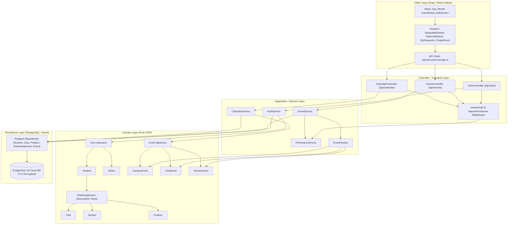
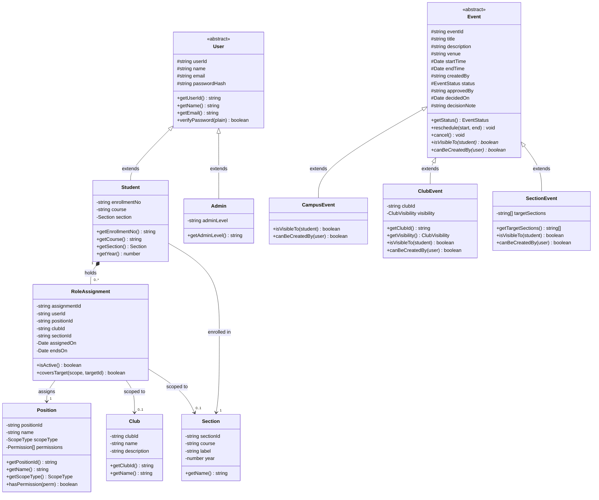
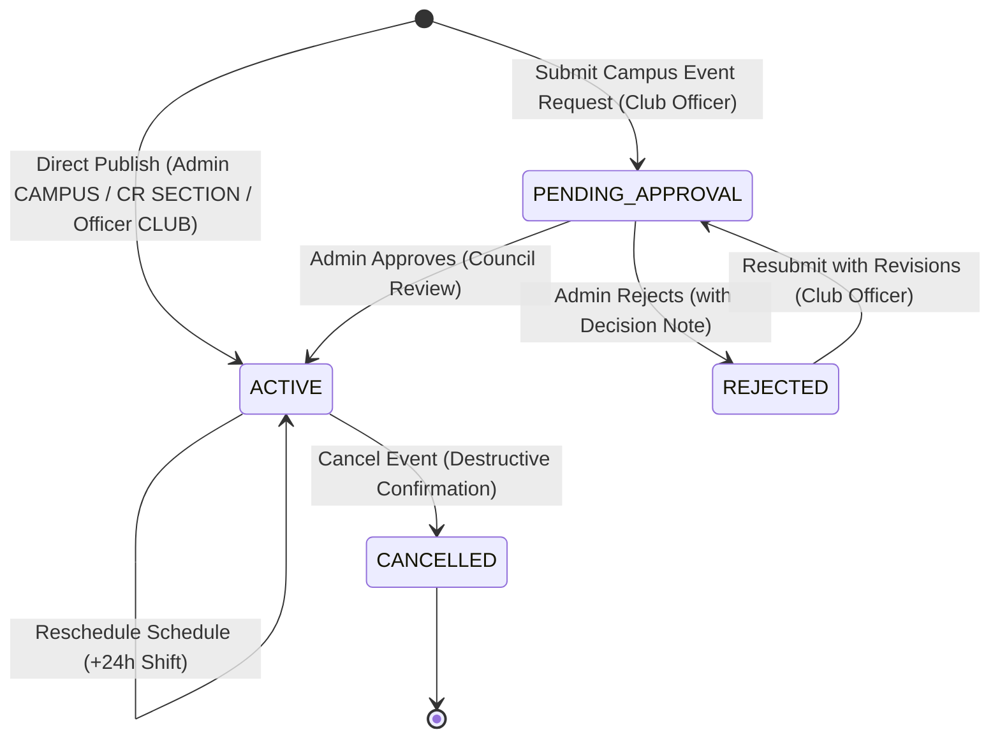
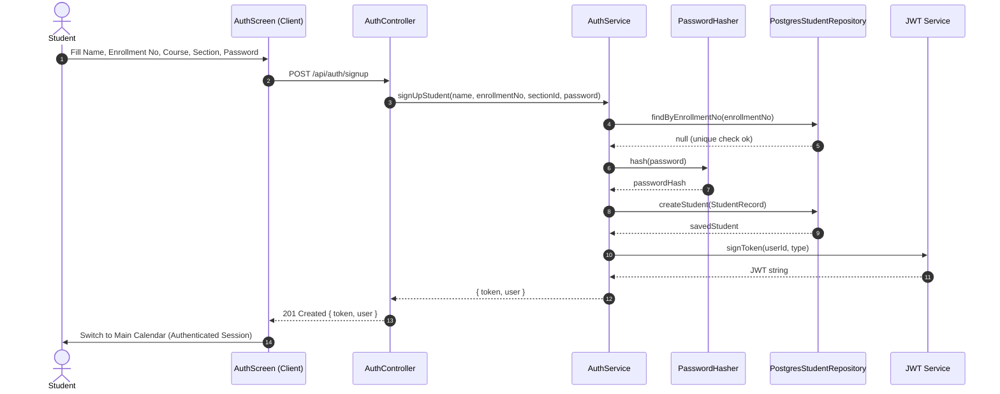
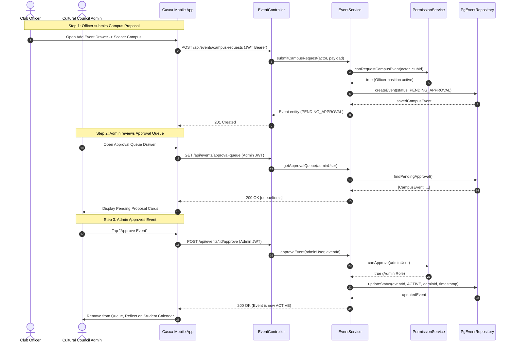
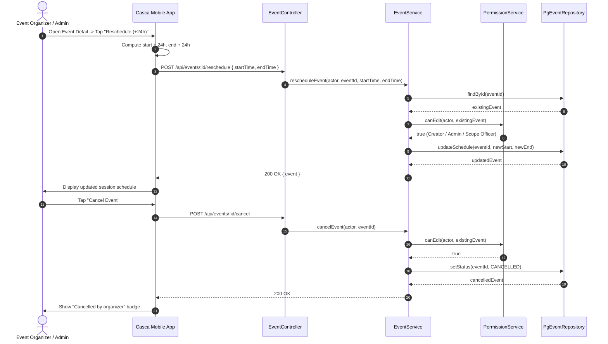

# System Architecture & UML Design Guide

**Campus Management Platform (Casca)** — Object-Oriented Software Engineering Architecture & Specification.

---

## 1. Architectural Layers & Component Architecture

The platform follows a strict **4-layer Clean Architecture** with unidirectional dependencies pointing inwards towards domain invariants:

---

## 2. Complete UML Class Diagram

The object model reflects pure Object-Oriented principles, leveraging inheritance, polymorphic dispatch, encapsulation, and association classes:

---

## 3. Event Lifecycle State Machine

Events transition through distinct states governed by role permissions and moderation workflows:

---

## 4. Sequence Diagrams

### 4.1 Student Self Sign-Up & Authentication Flow (UC-01, UC-13)

### 4.2 Campus Event Proposal & Cultural Council Approval Flow (UC-14, UC-15)

### 4.3 Event Mutation: Reschedule & Cancellation Flow (UC-08)

---

## 5. Core OOP Principles Applied

| OOP Principle         | Concrete Implementation in Casca                                                                                                                                                                                                                     |
| :-------------------- | :--------------------------------------------------------------------------------------------------------------------------------------------------------------------------------------------------------------------------------------------------- |
| **Inheritance**       | `User` (abstract base) &rarr; `Student`, `Admin` `Event` (abstract base) &rarr; `CampusEvent`, `ClubEvent`, `SectionEvent`                                                                                                                        |
| **Polymorphism**      | `Event.isVisibleTo(student)` and `Event.canBeCreatedBy(user)` are abstract methods implemented independently by each event subclass. `CalendarService` aggregates collections of `Event` polymorphically without type inspection or runtime casting. |
| **Encapsulation**     | Private attributes, constructor-enforced invariants (immutable `enrollmentNo`, valid date intervals), and domain accessors.                                                                                                                          |
| **Abstraction**       | Repository interfaces conceal SQL queries from domain services; UI services hide HTTP network communication and offline caching details.                                                                                                             |
| **Association Class** | `RoleAssignment` bridges `Student` and `Position` while recording scope parameters (`clubId`, `sectionId`, `assignedBy`, `assignedOn`, `endsOn`).                                                                                                    |
| **Factory Pattern**   | `EventFactory` encapsulates scope-driven subclass instantiation (`CAMPUS`, `CLUB`, `SECTION`).                                                                                                                                                       |

---

## 6. Client Architecture & Quality Assurance

- **Framework**: React Native with Expo and TypeScript.
- **Deduplicated Date Utilities**: Shared date formatting and calendar grid generation located in `client/src/utils/date.ts`.
- **Reusable Gesture Drawer**: Shared swipeable sheet component `SwipeableDrawer.tsx` powering Profile/Settings, Event Authoring, Approval Queue, and My Requests.
- **Graceful Offline Degradation**: Rich fallback datasets and optimistic client state keep the app responsive even when disconnected from the backend.
- **Automated Testing**:
  - **Backend**: 11 test files, 96 unit tests covering domain classes, permission rules, and event services.
  - **Client**: 3 test suites, 36 unit tests covering date utilities, theme contrast tokens, and API offline workflows.
  - **Total**: 132 automated tests passing.
