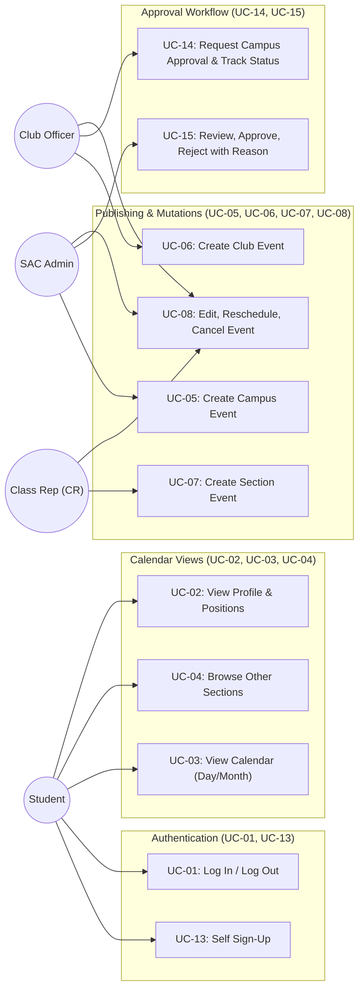
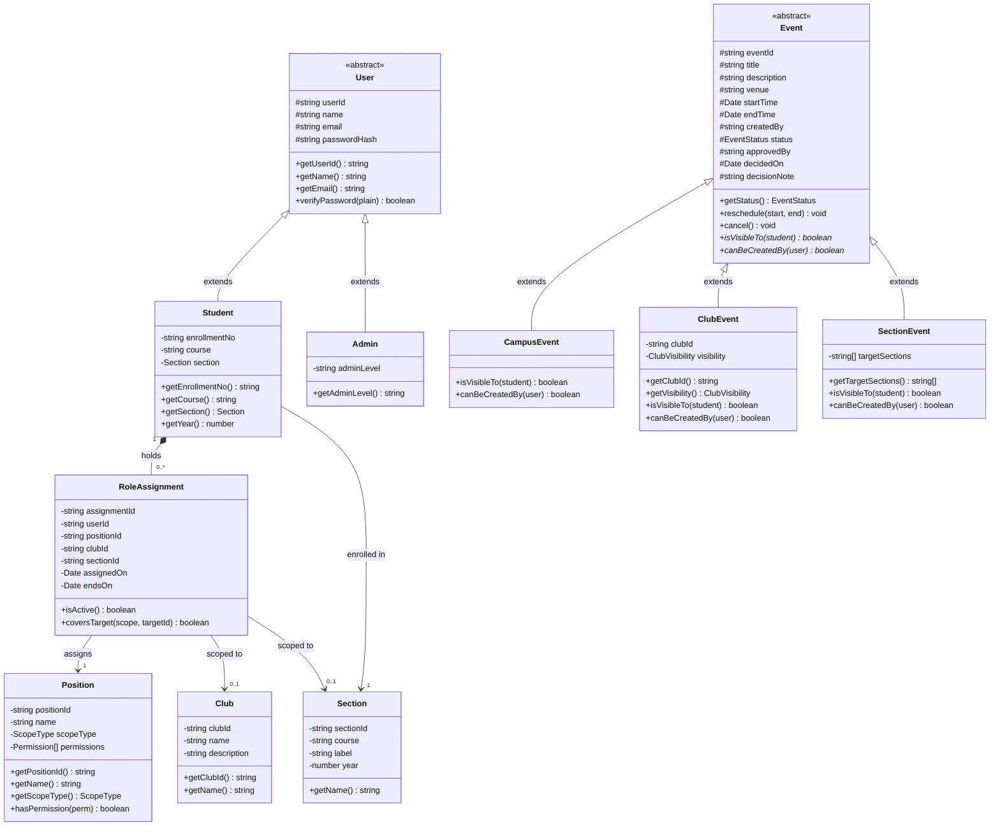
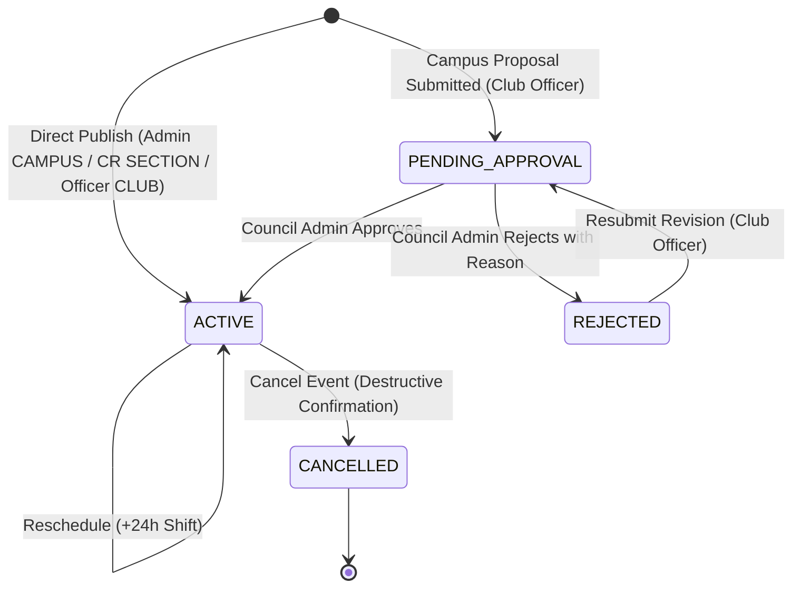

# Campus Management Platform — Design Document

**OOPS & SE project · Team of 3 · Version 0.1 (draft for team review)**

---

## 1. About this document

This is the single source of truth for the team. It covers what we are building, who uses it, the use cases, the class design, the access rules, a suggested work split, test scenarios and open questions. If code and this document disagree, fix one of them the same day.
Items marked `[Assumption]` are my reading of the idea and need the team's confirmation. Section 14 lists decisions we still have to make.

---

## 2. Problem and goals

Campus information (events, club activities, class-specific notices) is scattered across chat groups. The platform gives every registered student one place to see a calendar filtered to what matters to them, and gives the right people (club office bearers, class representatives, admins) controlled ability to publish to it.

### Goals

- One registry of all students with name, enrollment number, year, course, section, clubs and positions.
- One shared calendar where an event is either campus-wide, hosted by a club, or specific to one or more sections.
- Role-based publishing: what you can add depends on the positions you hold.
- Any student can browse other sections' events (read-only) if they choose to.
- **Non-goals for v1**: attendance, fees, grades, regular lecture timetable, chat, payments, notifications (planned as a later extension), faculty or staff accounts (no separate faculty actor in v1).

---

## 3. Actors and roles

| Actor                         | Who they are                                                                                                       | What they can do                                                                                                                                                   |
| :---------------------------- | :----------------------------------------------------------------------------------------------------------------- | :----------------------------------------------------------------------------------------------------------------------------------------------------------------- |
| **Student**                   | Every registered user                                                                                              | View calendar, view own profile, switch to other sections' view, see club list                                                                                     |
| **Club office bearer**        | A Student holding a club position with publishing rights (President, Vice-President, Secretary, Coordinator, etc.) | Everything a Student can, plus publish and manage events for their club, and request admin approval for campus-wide events                                         |
| **Class Representative (CR)** | A Student holding the CR position for one section                                                                  | Everything a Student can, plus publish and manage events for their own section                                                                                     |
| **Admin**                     | Staff or a designated senior student                                                                               | Manage the registry, clubs, positions and role assignments; publish campus-wide events; approve or reject club requests for campus-wide events; moderate any event |

> [!IMPORTANT]
> **Key design rule**: Office bearer and CR are not separate user types. They are a `Student` plus one or more role assignments. One student can be a member of three clubs, secretary of one, and CR of a section at the same time. Permissions are always computed from the current role assignments, never stored on the student.

---

## 4. Academic structure: sections

| Course    | Sections |
| :-------- | :------- |
| **IT**    | A, B, C  |
| **IT-BI** | C        |
| **ECE**   | D        |

This gives five section names, confirmed as the complete list (ECE has only section D): `IT-A`, `IT-B`, `IT-C`, `IT-BI-C`, `ECE-D`. Section names repeat every year, so a section is modelled as a `(course, label, year)` triple: first-year IT-A and second-year IT-A are different sections, and IT-C and IT-BI-C stay distinct even though both are lettered C. A student's year is derived from the year of their section. Every student belongs to exactly one section.

---

## 5. Functional requirements

| ID        | Requirement                                                                                                                                                            | Priority |
| :-------- | :--------------------------------------------------------------------------------------------------------------------------------------------------------------------- | :------- |
| **FR-1**  | Students self sign-up with name, enrollment number, course, section (year follows from the section) and password; the enrollment number must not already be registered | Must     |
| **FR-2**  | Students log in with enrollment number and password                                                                                                                    | Must     |
| **FR-3**  | Admin can create clubs and define positions with their permissions                                                                                                     | Must     |
| **FR-4**  | A student can belong to multiple clubs and hold multiple positions                                                                                                     | Must     |
| **FR-5**  | Authorised roles can create, edit, reschedule and cancel events within their scope                                                                                     | Must     |
| **FR-6**  | Calendar shows campus-wide events, club events and the student's own section events by default                                                                         | Must     |
| **FR-7**  | Any student can add other sections to their calendar view (read-only)                                                                                                  | Must     |
| **FR-8**  | Calendar can be filtered by date range, club and section                                                                                                               | Should   |
| **FR-9**  | Admin can assign and revoke positions; changes take effect immediately                                                                                                 | Must     |
| **FR-10** | Notification when an event is created, changed or cancelled (not in v1; later extension)                                                                               | Later    |
| **FR-11** | Audit log of role changes and event edits                                                                                                                              | Should   |
| **FR-12** | Admin can edit or remove a student account (for example a wrong or duplicate sign-up)                                                                                  | Should   |
| **FR-13** | A club office bearer can request approval of a CAMPUS event from an admin; the event is published only after an admin approves it                                      | Must     |
| **FR-14** | Admin can approve or reject a pending campus-event request with a reason; the requester can see the status of each request                                             | Must     |

---

## 6. Access rules (the heart of the system)

### 6.1 Event scopes

| Scope       | Meaning                                                                            | Visible by default to                                                                                 |
| :---------- | :--------------------------------------------------------------------------------- | :---------------------------------------------------------------------------------------------------- |
| **CAMPUS**  | Official campus-wide event (published by Admin, or by a club after admin approval) | All students                                                                                          |
| **CLUB**    | Hosted by one club                                                                 | All students by default; a club can mark an event members-only, then only members of that club see it |
| **SECTION** | Specific to one or more sections                                                   | Students of the target section(s)                                                                     |

### 6.2 Who can publish what

| Position                                          | Position scope | Can publish                                                                                                                                                        |
| :------------------------------------------------ | :------------- | :----------------------------------------------------------------------------------------------------------------------------------------------------------------- |
| **Admin**                                         | Campus         | CAMPUS events directly; approves or rejects club requests for CAMPUS events; can edit or cancel any event                                                          |
| **Club President / VP / Secretary / Coordinator** | Club           | CLUB events for the club where the position is held (public or members-only). CAMPUS events: can request approval from an admin, cannot publish directly (see 6.5) |
| **Club Member**                                   | Club           | Nothing (read-only). Can see the club's members-only events                                                                                                        |
| **Class Representative**                          | Section        | SECTION events for their own section only                                                                                                                          |

A student's rights are the union of all their role assignments, but each assignment only applies within its own scope. Being secretary of the Coding Club gives no right to publish for the Music Club.

### 6.3 Who sees what

- **Default calendar for a student** = all CAMPUS events + CLUB events the student is allowed to see (public club events, plus members-only events of clubs the student belongs to) + SECTION events of their own section.
- Other sections' events are hidden by default. The calendar has a section selector: the student can add any other section to their view and will then see that section's events as read-only. This is a view preference only and gives no right to edit.

### 6.4 Who can edit or cancel

The creator, anyone currently holding the same publishing permission for that event's scope, and Admin.

### 6.5 Campus event approval

In the college, an event needs approval from the cultural council first. So club office bearers (society presidents and the other publishing positions) do not publish CAMPUS events directly; they request approval from an admin.

1. The office bearer submits a campus event request. The event is saved with status `PENDING_APPROVAL` and is visible only to the requester and Admins, not on student calendars.
2. An Admin approves it: status becomes `ACTIVE`, approver and time are recorded, and the event shows on every student's calendar like any CAMPUS event.
3. An Admin rejects it with a reason: status becomes `REJECTED`. The requester sees the reason and may edit and resubmit.
4. Only an Admin can approve or reject, and never their own request. Admin can still publish CAMPUS events directly.
5. There are no push notifications in v1, so the requester checks the status in a "My requests" list.
   `[Assumption]` Cultural council members hold Admin accounts, so "admin" covers the council and there is no separate approver role in v1.

---

## 7. Use cases

### 7.1 Use case list

| ID        | Use case                                      | Primary actor       | Priority |
| :-------- | :-------------------------------------------- | :------------------ | :------- |
| **UC-01** | Log in / log out                              | Student             | Must     |
| **UC-02** | View own profile (clubs and positions)        | Student             | Must     |
| **UC-03** | View calendar (default view)                  | Student             | Must     |
| **UC-04** | View another section's events                 | Student             | Must     |
| **UC-05** | Create campus-wide event                      | Admin               | Must     |
| **UC-06** | Create club event                             | Club office bearer  | Must     |
| **UC-07** | Create section event                          | CR                  | Must     |
| **UC-08** | Edit, reschedule or cancel an event           | Event owner / Admin | Must     |
| **UC-09** | Manage student accounts (edit or remove)      | Admin               | Should   |
| **UC-10** | Create club and define positions              | Admin               | Must     |
| **UC-11** | Assign or revoke a position                   | Admin               | Must     |
| **UC-12** | Receive event notifications (later extension) | Student             | Later    |
| **UC-13** | Sign up (self-registration)                   | New student         | Must     |
| **UC-14** | Request campus event approval                 | Club office bearer  | Must     |
| **UC-15** | Approve or reject a campus event request      | Admin               | Must     |

### 7.2 Use Case Diagram

---

## 8. Class design

### 8.1 Classes and responsibilities

**Domain classes:**

- `User` (abstract): `userId`, `name`, `email`, `passwordHash` | `login()`, `logout()`, `changePassword()`
- `Student` (extends `User`): `enrollmentNo` (unique, immutable), `course`, `section`, `roleAssignments`; year derived from section | `getClubs()`, `getActivePositions()`, `hasPermission(permission, scopeTarget)`
- `Admin` (extends `User`): `adminLevel` | powers come from `PermissionService`
- `Section`: `sectionId`, `course`, `label`, `year` | `getName()` (e.g., IT-A, year), `getStudents()`
- `Club`: `clubId`, `name`, `description` | `getOfficeBearers()`, `getMembers()`
- `Position`: `positionId`, `name`, `scopeType` (CAMPUS / CLUB / SECTION), `permissions` | `allows(permission)`
- `Permission` (enum): `CREATE_CAMPUS_EVENT`, `REQUEST_CAMPUS_EVENT`, `APPROVE_CAMPUS_EVENT`, `CREATE_CLUB_EVENT`, `CREATE_SECTION_EVENT`, `EDIT_ANY_IN_SCOPE`, `MANAGE_ROLES`, `MANAGE_REGISTRY`
- `RoleAssignment`: `student`, `position`, `club` (nullable), `section` (nullable), `assignedBy`, `assignedOn`, `endsOn` | `isActive()`, `coversTarget(target)`
- `Event` (abstract): `eventId`, `title`, `description`, `venue`, `startTime`, `endTime`, `createdBy`, `createdAt`, `status` (PENDING_APPROVAL, ACTIVE, REJECTED, CANCELLED), `approvedBy`, `decidedOn`, `decisionNote` | `isVisibleTo(student)` (abstract), `canBeCreatedBy(user)` (abstract), `reschedule()`, `cancel()`
- `CampusEvent` (extends `Event`): `isVisibleTo()` returns true for every student once ACTIVE; while PENDING_APPROVAL or REJECTED, only requester and Admins see it.
- `ClubEvent` (extends `Event`): `club`, `visibility` (PUBLIC / MEMBERS_ONLY) | `isVisibleTo()` checks club membership if MEMBERS_ONLY; `canBeCreatedBy()` checks club position.
- `SectionEvent` (extends `Event`): `targetSections` | `isVisibleTo()` checks if student's section is in targetSections; `canBeCreatedBy()` checks CR of target section(s).

**Service classes:**

- `AuthService`: Authentication and sessions (`login`, `logout`)
- `PermissionService`: Centralized authorization (`canPublish`, `canRequestCampusEvent`, `canApprove`, `canEdit`, `canManageRoles`)
- `EventService`: Event lifecycle management (`createEvent`, `requestCampusEvent`, `approveEvent`, `rejectEvent`, `updateEvent`, `cancelEvent`)
- `EventFactory`: Instantiates appropriate `Event` subclass from scope
- `CalendarService`: Aggregates visible events (`getCalendar(student, filter)`)
- `CalendarFilter`: View criteria (`dateRange`, `clubs`, `extraSections`)
- `RegistryService`: Student, club, and role administration (`registerStudent`, `assignPosition`, `revokePosition`, etc.)

### 8.2 OOP concepts and patterns used

- **Inheritance**: `User` -> `Student`, `Admin`; `Event` -> `CampusEvent`, `ClubEvent`, `SectionEvent`
- **Polymorphism**: `Event.isVisibleTo()` and `Event.canBeCreatedBy()` overridden per subclass
- **Abstraction**: `Event` and `User` are abstract; repositories hide persistence; services hide domain complexity
- **Encapsulation**: Private fields, constructor validation, immutable identifiers
- **Association Class**: `RoleAssignment` bridges `Student` and `Position` with contextual scope (`club`, `section`, `dates`)
- **Factory Pattern**: `EventFactory` selects and constructs `Event` subclasses
- **Single Responsibility Principle**: Authorization logic isolated inside `PermissionService`

### 8.3 UML Class Diagram

### 8.4 Event Lifecycle State Machine

---

## 9. Suggested data model (PostgreSQL on Aiven)

- `users`: `user_id`, `name`, `email`, `password_hash`, `user_type` (STUDENT / ADMIN)
- `students`: `user_id` (FK), `enrollment_no` (unique), `course`, `section_id` (FK)
- `sections`: `section_id`, `course`, `label`, `year` (unique together)
- `clubs`: `club_id`, `name`, `description`
- `positions`: `position_id`, `name`, `scope_type`
- `position_permissions`: `position_id`, `permission`
- `role_assignments`: `id`, `student_id`, `position_id`, `club_id` (nullable), `section_id` (nullable), `assigned_by`, `assigned_on`, `ends_on`
- `events`: `event_id`, `event_type`, `title`, `description`, `venue`, `start_time`, `end_time`, `created_by`, `club_id` (nullable), `club_visibility` (nullable), `status`, `approved_by` (nullable), `decided_on` (nullable), `decision_note` (nullable)
- `event_sections`: `event_id`, `section_id`

---

## 10. Architecture & Stack

- **Architecture**: 4-Layer Clean Architecture: UI -> Controllers/API -> Services -> Domain Model -> Repositories -> Database.
- **Client**: React Native (Expo) with TypeScript.
- **Backend API**: Node.js + Express with TypeScript.
- **Database**: PostgreSQL hosted on Aiven (managed cloud service with TLS).
- **Time Handling**: All timestamps stored in UTC (`timestamptz`), presented in IST.

---

## 11. Work split for team of 3

- **Member A (Domain & Access Control)**: `User`, `Student`, `Section`, `Club`, `Position`, `RoleAssignment`, `AuthService` (including sign-up), `PermissionService`, `RegistryService`.
- **Member B (Events & Calendar)**: `Event` hierarchy, `EventFactory`, `EventService`, `CalendarService`, `CalendarFilter`, visibility logic, campus-event approval workflow.
- **Member C (Interface & Quality)**:
  - **Core Screens & Workflows [Completed]**: Calendar day & month views, event details sheet, dedicated swipeable drawers (`SwipeableDrawer.tsx`), Approval Queue drawer (`ApprovalQueueDrawer.tsx`, UC-15), My Requests & Resubmission drawer (`MyRequestsDrawer.tsx`, UC-14), Event Mutations (edit, reschedule, cancel, UC-08), and Full Auth Screen (`AuthScreen.tsx`, UC-01, UC-13).
  - **Design System & Theme [Completed]**: Impeccable Warm Sand editorial design system, Light and Dark mode tokens authored from first principles with full contrast compliance.
  - **Deduplication & Utilities [Completed]**: Unified date arithmetic and matrix generation in `client/src/utils/date.ts`.
  - **Quality Gates & Automated Tests [Completed]**: Configured Vitest test runner for client; implemented 36 client unit tests across date utilities, theme tokens, and API offline service mappers (total 132 automated tests passing across workspaces).
  - **UML & Architecture Documentation [Completed]**: Authored system component diagrams, UML class diagrams, state machine, and sequence diagrams in `docs/ARCHITECTURE.md` and `docs/design/DESIGN_DOCUMENT.md`.
